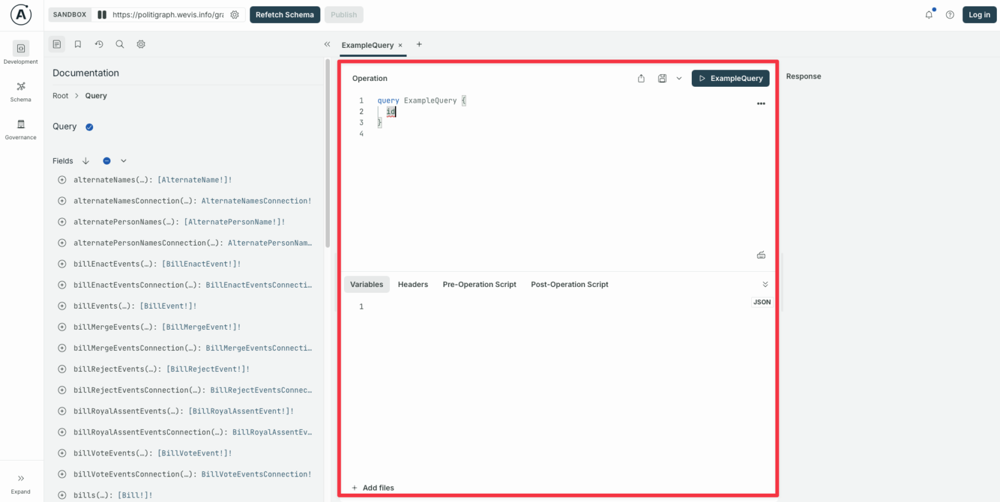
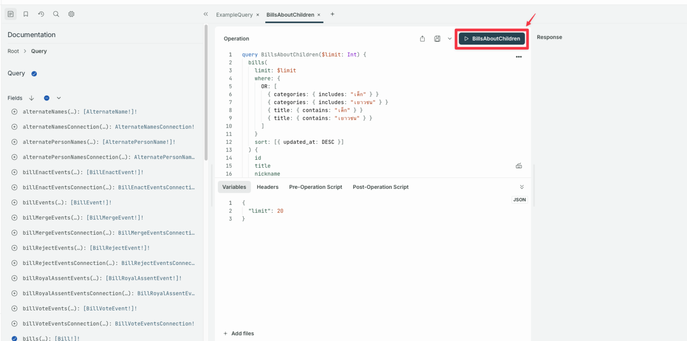
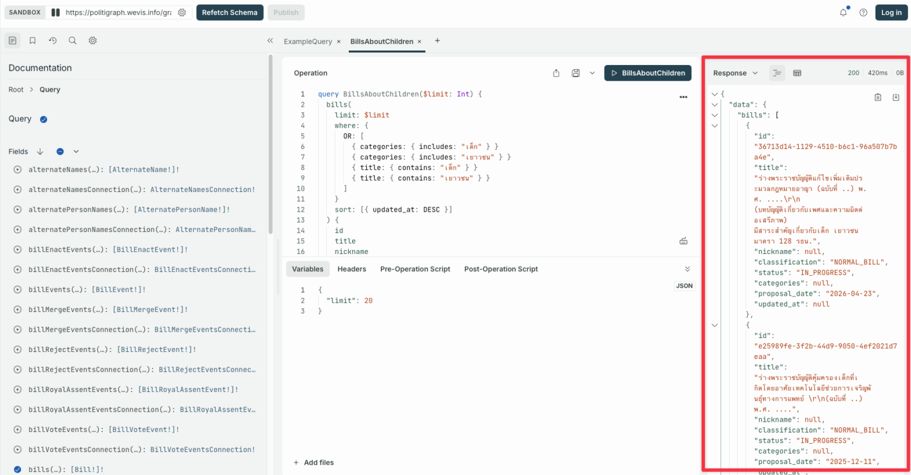
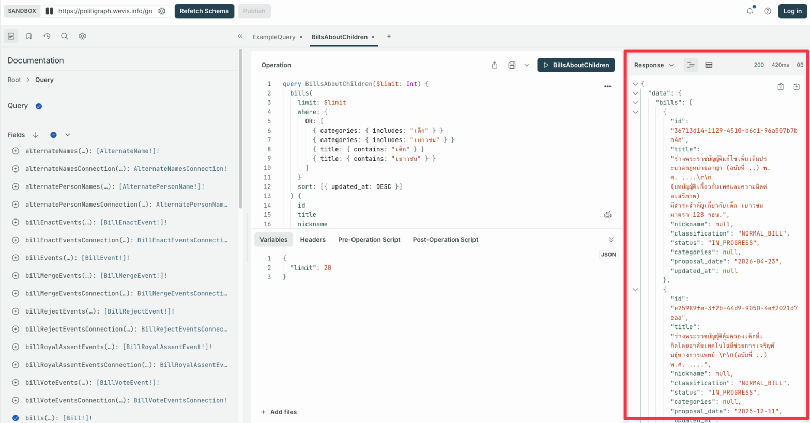

import { Card, Code, Steps } from '@astrojs/starlight/components';
import Accordion from '../../../../components/accordion.astro';
import { SITE_URL } from '../../../../constants/site';

You can access data from 🗄️ Politigraph in 3 ways

1.  **Use the API**

    ```text wrap
    💻 — Query → 🗄️ — Data → 💻
    ```

    Best for integrating Politigraph data into a website, application, or other workflow by writing a GraphQL query and sending it to the API to fetch the data you need.

    [See how](#1-using-the-api) ⬇️

2.  **Use the 🛝 GraphQL Playground**

    ```text wrap
    👦 — Build Query → 🛝 — Query → 🗄️ — Data → 🛝 — Result →👦
    ```

    Best for pulling data out of Politigraph with a UI that helps you write GraphQL queries, view results, and download the data right away without writing any code.

    [See how](#2-using-the-graphql-playground) ⬇️

3.  **Use It with AI 🤖**

    Best for pulling data out of Politigraph to answer a question or help analyze it, without writing a GraphQL query yourself. AI can help in 2 ways.

    1.  **Have AI write the query for you to use in the GraphQL Playground**

        ```text wrap
        👦 — Ask (Prompt) → 🤖 — Drafts the query → 👦 — Build Query → 🛝 — Query → 🗄️ — Data → 🛝 — Result → 👦
        ```

        Best for users of web AI chatbots, which may be limited in calling external data.

        [See how](#31-let-ai-draft-the-query) ⬇️

    2.  **Let AI fetch the data and answer with it**

        ```text wrap
        👦 — Ask (Prompt) → 🤖 — Query → 🗄️ — Analyzes data → 🤖 — Answer → 👦
        ```

        Best for an on-device AI agent that supports connecting to external systems through the Model Context Protocol (MCP).

        [See how](#32-let-ai-fetch-the-data-and-answer) ⬇️

## 1. Using the API

Our API adheres to the [GraphQL](https://graphql.org) standard, which you can query at <code>{SITE_URL}/graphql</code> through a [GraphQL Client or HTTP Request](https://www.graphql-js.org/docs/graphql-clients/)

:::note[Identifying your application]
If you call the API from a server, script, or SSR, please send the `apollographql-client-name` header and, optionally, `apollographql-client-version` so we can see usage statistics. Requests from a browser are already identified by their origin automatically.
:::

## 2. Using the GraphQL Playground

<Steps>

1.  Open the [GraphQL Playground](/graphql)

2.  Write your query in the boxed area shown below

    

3.  Press ▶️ to run the query

    

4.  The data appears in the Response panel

    

5.  Press the download button to export the data as JSON

    

    Note: Safari and Firefox limit downloading data from the GraphQL Playground, but you can still copy the result to use elsewhere.

</Steps>

## 3. Using It with AI

You can use Politigraph with AI in 2 ways.

### 3.1 Let AI Draft the Query

<Steps>

1.  Send the **llms.txt** URL <code>{SITE_URL}/llms-full.txt</code> for AI to read, so it understands the data structure and can help write the query you need.

    <Accordion title="Example prompt">
    	Understand Politigraph from {SITE_URL}/llms-full.txt, then write a query
    	to find which representative was absent from the most vote events in the
    	current term.
    </Accordion>

    <Accordion title="Example answer from ChatGPT">
    	
    </Accordion>

2.  Use the query in the GraphQL Playground, the same way as method 2.

</Steps>

llms.txt is a guide file that AI can read following the llms.txt standard. Politigraph provides 3 related files:

- [`/llms.txt`](/llms.txt): an index of every documentation page, with links
- [`/llms-full.txt`](/llms-full.txt): the entire documentation plus the full GraphQL schema in a single file
- [`/llms-th.txt`](/llms-th.txt) and [`/llms-full-th.txt`](/llms-full-th.txt): the same in Thai, the source of truth for the Thai terms used in the data. Prefer these when asking in Thai (`/llms.txt` and `/llms-full.txt` are English)
- [`/schema.graphql`](/schema.graphql): the complete GraphQL schema (SDL)

You can send the URL <code>{SITE_URL}/llms-full.txt</code> to give AI everything at once, or <code>{SITE_URL}/llms.txt</code> to let it pick only the documents relevant to the question, which may reduce token usage but risks AI missing important information or requirements from the documents it didn't read.

### 3.2 Let AI Fetch the Data and Answer

<Steps>

1.  If your AI agent supports the [Model Context Protocol (MCP)](https://modelcontextprotocol.io), you can connect it to our MCP endpoint at <code>{SITE_URL}/mcp</code>. No authentication or API key is required.

    <Code
    	code={`{ "type": "http", "url": "${SITE_URL}/mcp" }`}
    	lang="json"
    	title="Example MCP client configuration"
    	wrap
    />

2.  Once connected, you can prompt AI to answer questions or help analyze issues from the data.

    <Accordion title="Example prompt">
    	Understand Politigraph from {SITE_URL}/llms-full.txt, then find which
    	party has had the most unified voting pattern from 2020 to the present.
    </Accordion>

    <Accordion title="Example answer from Claude">
    	
    </Accordion>

</Steps>

:::caution[AI responses can be inaccurate or misleading]
An AI agent may build a query that does not answer your question, misinterpret the schema, or state figures that never came from Politigraph at all.
Before relying on or publishing an answer, you should verify the result yourself, for example by re-running it in the [GraphQL Playground](/graphql).
:::

### Comparing Capabilities and Limitations Across AI Providers

An agent on your machine can read our documentation and send the query itself, so it can answer with real data. A chatbot in the browser can only read the documentation and help you write a query, but you have to run it yourself in the [GraphQL Playground](/graphql). Connect the chatbot to our MCP server if you want it to return real data.

#### Web chatbots

| Provider                                                                                                         | llms.txt                                                                                                                                                                | MCP server                                                                  |
| ---------------------------------------------------------------------------------------------------------------- | ----------------------------------------------------------------------------------------------------------------------------------------------------------------------- | --------------------------------------------------------------------------- |
| [ChatGPT](https://platform.openai.com/docs/guides/developer-mode)                                                | Reads it, drafts queries                                                                                                                                                | Custom connector in developer mode, on paid plans                           |
| [Claude](https://support.claude.com/en/articles/11175166-get-started-with-custom-connectors-using-remote-mcp)    | Reads it, drafts queries                                                                                                                                                | Custom connector on every plan, web and desktop, one connector when on free |
| [Gemini](https://support.google.com/g/answer/17106276)                                                           | Cannot read the llms.txt URL's content directly, you must copy the content from <code>{SITE_URL}/llms-full.txt</code> into the prompt before asking it to write a query | Custom app in Spark on AI Pro and Ultra, or through an admin on Business    |
| [Perplexity](https://www.perplexity.ai/help-center/en/articles/13915507-adding-custom-remote-connectors)         | Reads it, drafts queries                                                                                                                                                | Custom remote connector, on paid plans                                      |
| [Microsoft Copilot](https://learn.microsoft.com/en-us/microsoft-copilot-studio/mcp-add-existing-server-to-agent) | Reads it, drafts queries                                                                                                                                                | Only through an agent you build in Copilot Studio                           |

#### Local coding agents

| Client                                                                                     | llms.txt                      | MCP server                        |
| ------------------------------------------------------------------------------------------ | ----------------------------- | --------------------------------- |
| [Claude Code](https://docs.claude.com/en/docs/claude-code/mcp)                             | Reads it and runs queries     | Yes                               |
| [Codex CLI](https://developers.openai.com/codex/agent-approvals-security)                  | Needs `network_access = true` | Yes                               |
| [Gemini CLI](https://google-gemini.github.io/gemini-cli/docs/tools/mcp-server.html)        | Reads it and runs queries     | Yes, configured through `httpUrl` |
| [Cursor](https://cursor.com/docs/context/mcp)                                              | Reads it and runs queries     | Yes                               |
| [VS Code with GitHub Copilot](https://code.visualstudio.com/docs/copilot/chat/mcp-servers) | Reads it and runs queries     | Yes                               |

_Last checked on 7 September 2026_

## Limitations

### Access

Most data from the Politigraph API is publicly accessible and does not require authentication, with the following exceptions:

- Data with the field `publish_status` that does not have the value `PUBLISHED` will be hidden from the response because it is under review and not yet ready for disclosure.
- Any GraphQL mutation, as we prevent external parties from modifying data on our system.

Access to both of these exceptions is strictly reserved for the WeVis system administration team.

### API Usage Limits

To ensure fair usage and protect the API from abuse, we enforce the following limits on both GraphQL and MCP usage:

- **Rate limit**: 30 requests per 10 seconds
- **Batching**: 5 operations per batched request
- **Aliases**: 120 aliases per operation
- **Depth**: 10 levels of nested operation
- **Tokens**: 10,000 tokens per operation

Exceeding these limits will result in an error response.

### Node Limits

Certain types of data, such as "People" and individual "Votes", contain a large number of nodes within the system.
We must limit the number of nodes returned to the user to no more than 1,000 nodes per query.
If you need to retrieve more data than this limit allows, please [read more about using Pagination on GraphQL](https://neo4j.com/docs/graphql/current/queries-aggregations/pagination/).

## License

Regarding the data, the team intends to open it as Open Data under the [Attribution-NonCommercial 4.0 International](https://creativecommons.org/licenses/by-nc/4.0/) terms. This means you can use, modify, and build upon the data, but it cannot be used for commercial purposes or to seek profit from the work, and credit must be given to WeVis.

Regarding the source code, the team intends to develop every project as Open Source under the [Attribution-NonCommercial-ShareAlike 4.0 International](https://creativecommons.org/licenses/by-nc-sa/4.0/) terms. This means you can use, modify, and build upon the work, but it cannot be used for commercial purposes or to seek profit from the work. You must provide notice and credit to the work's owner, and the resulting work must be under the same Creative Commons license conditions as the original. WeVis Ltd. and Punch Up Ltd. are joint licensors.
