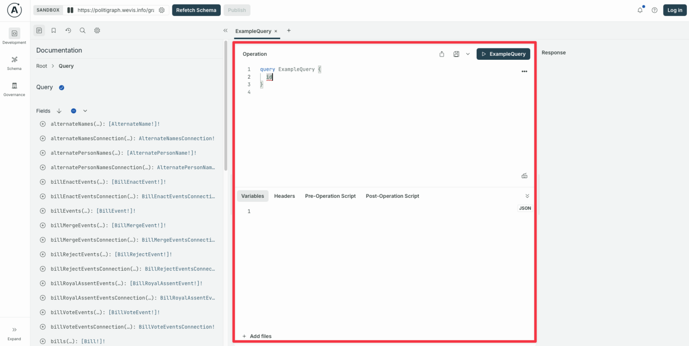
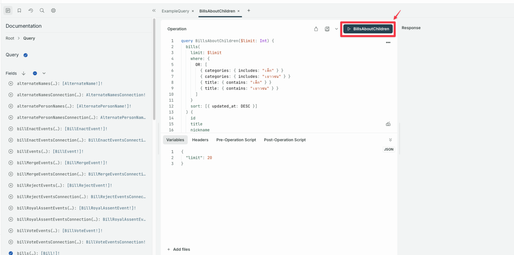
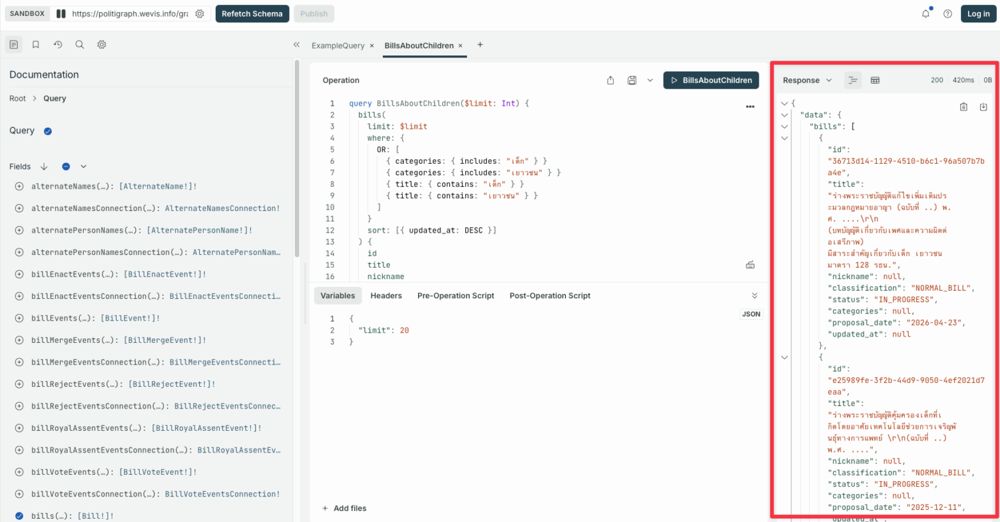
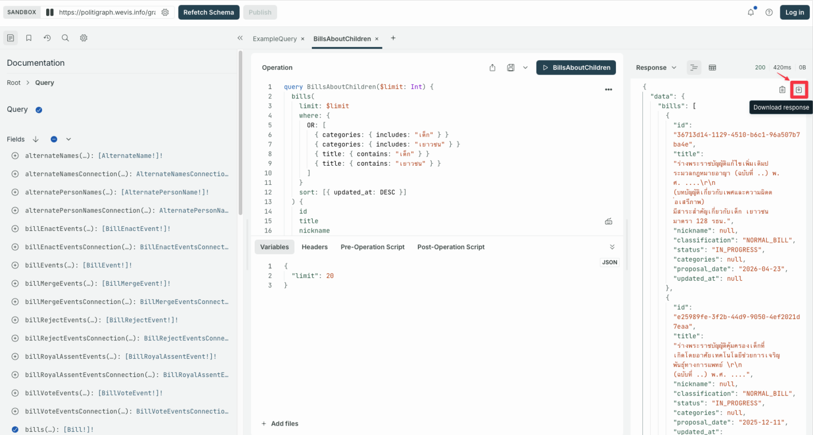

import { Steps } from '@astrojs/starlight/components';

Best for pulling data out of Politigraph with a UI that helps you write GraphQL queries, view results, and download the data right away without writing any code.

<Steps>

1.  Open the [GraphQL Playground](/graphql)

2.  Write your query in the boxed area shown below

    

3.  Press ▶️ to run the query

    

4.  The data appears in the Response panel

    

5.  Press the download button to export the data as JSON

    

    :::note
    Safari and Firefox limit downloading data from the GraphQL Playground, but you can still copy the result to use elsewhere.
    :::

</Steps>
