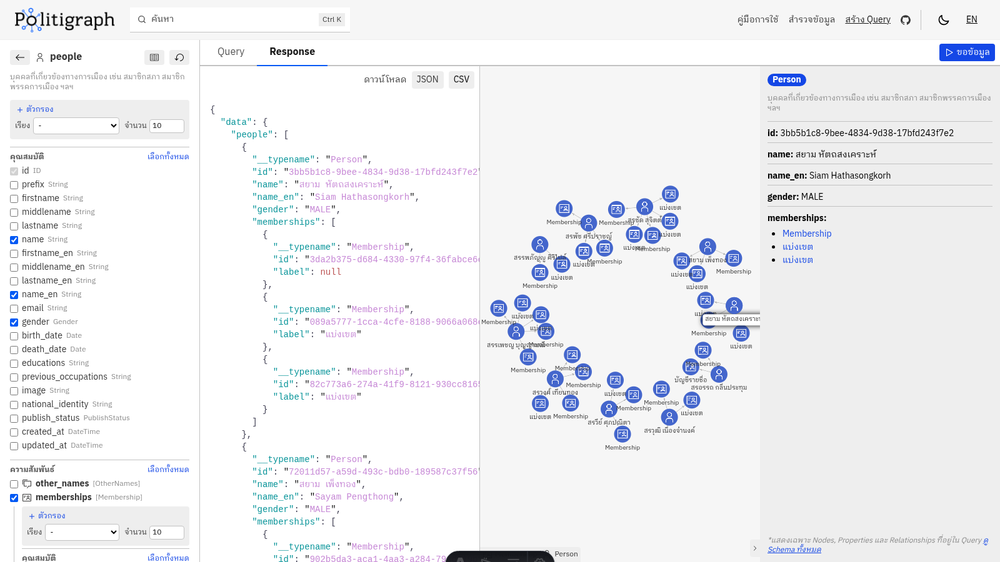
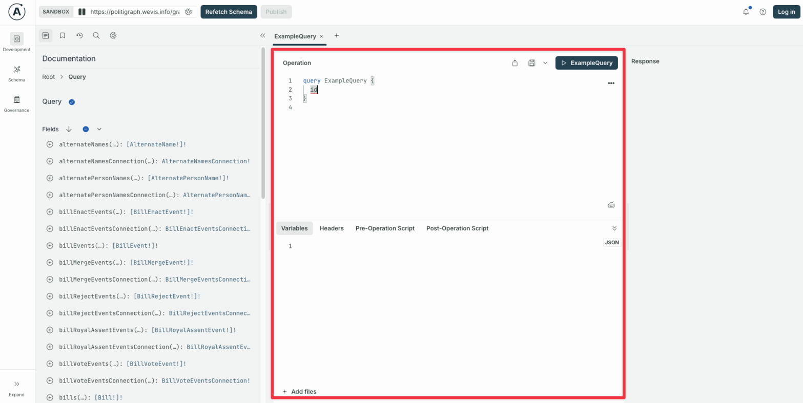
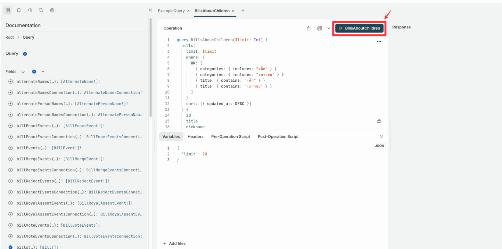
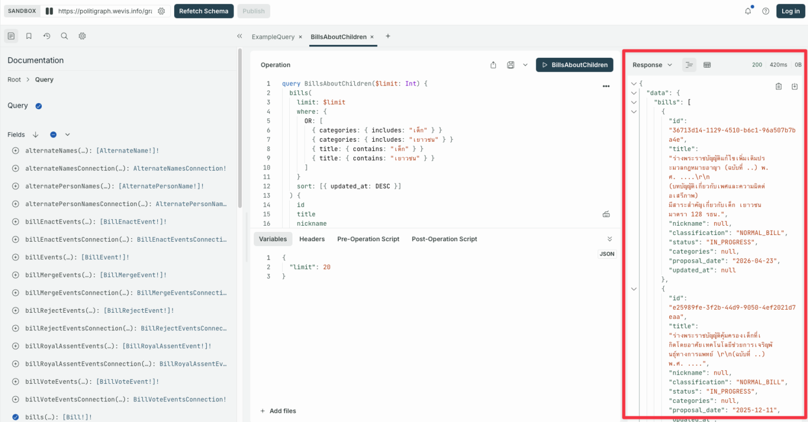
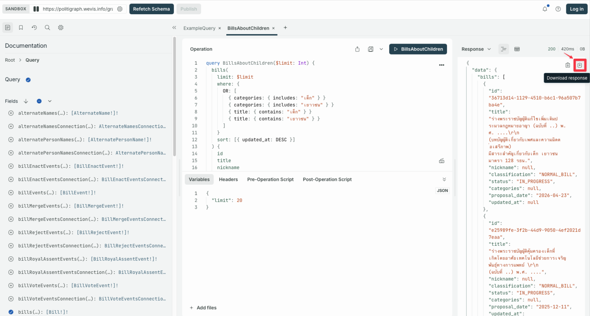

import { Steps } from '@astrojs/starlight/components';

Best for pulling data out of Politigraph with a UI that helps you build queries, view results, and download the data right away without writing any code. There are 2 tools to choose from.

- [Query Builder](#query-builder): best for people just getting started with Politigraph. Simply click to pick the data you want to build a GraphQL query and view the result with a Visualization.
- [GraphQL Playground](#graphql-playground): for more advanced users. Write more complex queries and use the full power of GraphQL.

## Query Builder

<Steps>

1.  Open the [Query Builder](/en/query-builder) and pick a **starting node** you are interested in, such as `people` or `bills`

2.  Choose the data you want in the left panel

    - **Properties**: pick the properties you need
    - **Relationships**: tick related data, such as the `memberships` of `people`, then pick its properties too
    - **Filter, Sort and Limit**: narrow the result down to the data you need

3.  Press **Request data** to fetch the data. The result appears in the **Response** tab as JSON or as a Visualization.

    

4.  Download the result as **JSON** or **CSV** at the top right of the result

    If the data has multiple levels of nested relationships, the CSV download is a ZIP. Each CSV file inside holds one node type, linked together by `id`.

5.  In the **Query** tab, copy the **Link** to share the query so others can open it, or copy the **Code** of the GraphQL query to use in the [GraphQL API](/en/usage/api) or the [GraphQL Playground](#graphql-playground)

</Steps>

:::note
The Query Builder only covers building basic queries for simple usage. For the full GraphQL feature set, use the GraphQL Playground.
:::

## GraphQL Playground

Best for people who are comfortable with GraphQL, or who already have a query from elsewhere, such as from [AI](/en/usage/ai).

<Steps>

1.  Open the [GraphQL Playground](/graphql)

2.  Write your query in the boxed area shown below

    

3.  Press ▶️ to run the query

    

4.  The data appears in the Response panel

    

5.  Press the download button to export the data as JSON

    

    :::note
    Safari and Firefox limit downloading data from the GraphQL Playground, but you can still copy the result to use elsewhere.
    :::

</Steps>
