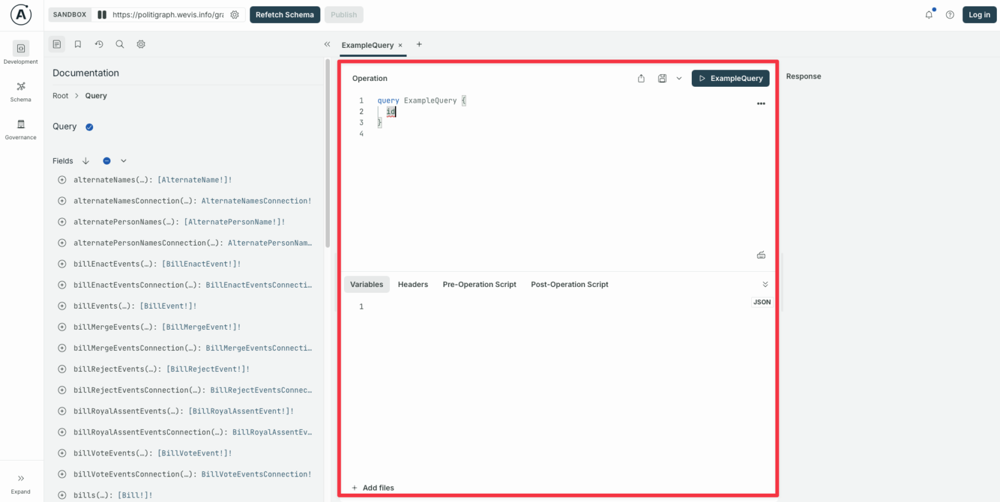
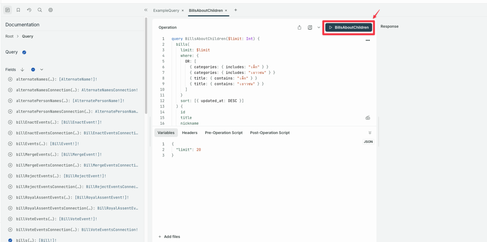
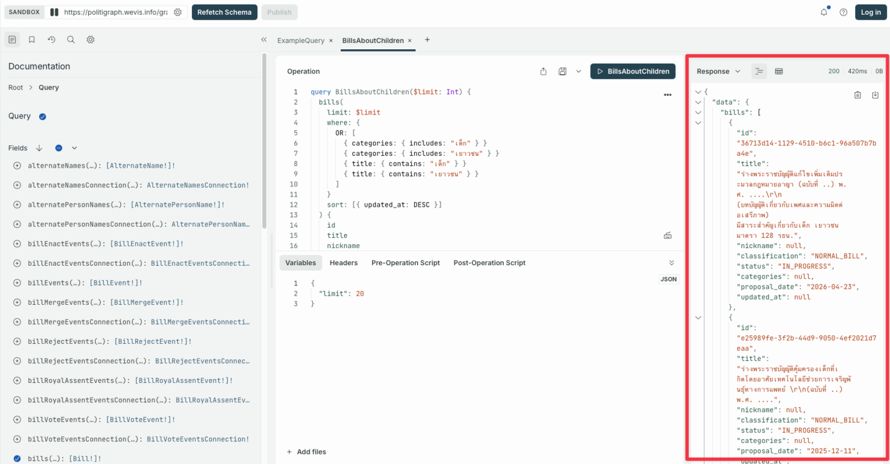
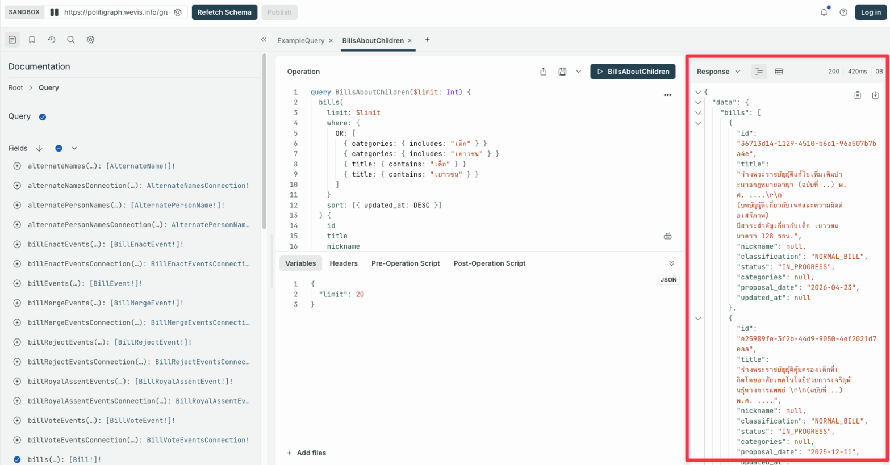

import { Card, Code, Steps } from '@astrojs/starlight/components';
import Accordion from '../../../components/accordion.astro';
import { SITE_URL } from '../../../constants/site';

คุณสามารถเข้าถึงข้อมูลจาก 🗄️ Politigraph ได้ 3 วิธี

1.  **ใช้งานผ่าน API**

    ```text wrap
    💻 — Query → 🗄️ — ข้อมูล → 💻
    ```

    เหมาะสำหรับผู้ที่ต้องการนำข้อมูล Politigraph ไปใช้ในเว็บไซต์ แอปพลิเคชัน หรือกระบวนการทำงานอื่น ๆ โดยเขียน GraphQL Query และส่งคำขอไปยังระบบเพื่อดึงข้อมูลที่ต้องการ

    [ดูวิธีใช้งาน](#1-การใช้งานผ่าน-api) ⬇️

2.  **ใช้งานผ่าน 🛝 GraphQL Playground**

    ```text wrap
    👦 — สร้าง Query → 🛝 — Query → 🗄️ — ข้อมูล → 🛝 — แสดงผล →👦
    ```

    เหมาะสำหรับผู้ที่ต้องการดึงข้อมูลจาก Politograph ออกมาใช้ โดยมี User Interface ช่วยในการเขียน GraphQL Query ดูผลลัพธ์ และดาวน์โหลดข้อมูลไปใช้ได้ทันทีโดนไม่ต้องเขียนโค้ดเพิ่มเติม

    [ดูวิธีใช้งาน](#2-การใช้งานผ่าน-graphql-playground) ⬇️

3.  **ใช้งานร่วมกับ AI 🤖**

    เหมาะสำหรับผู้ที่ต้องการดึงข้อมูลจาก Politograph ออกมาใช้ เพื่อตอบคำถามที่อยากทราบหรือนำไปวิเคราะห์ต่อ โดยไม่ต้องเขียน GraphQL Query ด้วยตัวเอง โดยสามารถใช้ AI ช่วยได้ 2 ช่องทาง

    1.  **ให้ AI เขียนคำสั่งสำหรับดึงข้อมูล และนำ Query ที่ AI ช่วยเขียนไปใช้ใน GraphQL playground**

        ```text wrap
        👦 — ถาม (Prompt) → 🤖 — ช่วยเขียน Query ให้→ 👦 — สร้าง Query → 🛝 — Query → 🗄️ — ข้อมูล → 🛝 — แสดงผล → 👦
        ```

        เหมาะสำหรับผู้ใช้งาน AI chatbot บนเว็บซึ่งอาจมีข้อจำกัดในการเรียกใช้ข้อมูล

        [ดูวิธีใช้งาน](#31-ให้-ai-ช่วยเขียนคำสั่งสำหรับดึงข้อมูล) ⬇️

    2.  **ให้ AI ดึงข้อมูลและนำผลลัพธ์มาตอบ**

        ```text wrap
        👦 — ถาม (Prompt) → 🤖 — Query → 🗄️ — วิเคราะห์ข้อมูล → 🤖 — ตอบ → 👦
        ```

        เหมาะสำหรับผู้ใช้งาน AI Agent บนเครื่อง และเป็น AI Agent ที่รองรับการเชื่อมต่อกับระบบภายนอกผ่าน Model Context Protocol (MCP)

        [ดูวิธีใช้งาน](#32-ให้-ai-ดึงข้อมูลและนำผลลัพธ์มาตอบ) ⬇️

## 1. การใช้งานผ่าน API

API ของเราอยู่ในมาตรฐาน [GraphQL](https://graphql.org) ซึ่งผู้ใช้สามารถขอข้อมูล (Query) ด้วย [GraphQL Client หรือ HTTP POST Request](https://www.graphql-js.org/docs/graphql-clients/) ได้ที่ <code>{SITE_URL}/graphql</code>

:::note[การระบุชื่อแอปพลิเคชัน]
หากเรียกใช้ API จาก server, script หรือ SSR กรุณาส่ง Header `apollographql-client-name` และ `apollographql-client-version` (ไม่บังคับ) เพื่อให้เราทราบสถิติการใช้งาน ส่วน Request ที่มาจากเบราว์เซอร์นั้นระบุที่มาจาก Origin โดยอัตโนมัติ
:::

## 2. การใช้งานผ่าน GraphQL Playground

<Steps>

1.  เปิด [GraphQL Playground](/graphql)

2.  เขียน Query ในช่องที่ถูกล้อมกรอบดังภาพ

    

3.  กดปุ่ม ▶️ เพื่อเรียกข้อมูล

    

4.  ข้อมูลจะปรากฏที่ช่อง Response

    

5.  กดปุ่ม download ข้อมูลออกมาในรูปแบบ JSON

    

    หมายเหตุ: Safari และ Firefox มีข้อจำกัดในการดาวน์โหลดข้อมูลจาก GraphQL Playground แต่ผู้ใช้ยังสามารถ Copy ผลลัพธ์ไปใช้ต่อได้

</Steps>

## 3. การใช้งานร่วมกับ AI

คุณสามารถใช้ Politigraph ร่วมกับ AI ได้ 2 ช่องทาง

### 3.1 ให้ AI ช่วยเขียนคำสั่งสำหรับดึงข้อมูล

<Steps>

1.  ส่ง URL ของ **llms.txt** <code>{SITE_URL}/llms-full.txt</code> ให้ AI อ่าน เพื่อทำความเข้าใจโครงสร้างข้อมูลและช่วยเขียน Query (คำสั่งสำหรับดึงข้อมูล) ตามที่ต้องการ

    <Accordion title="ตัวอย่าง Prompt">
    	ทำความเข้าใจ Politigraph จาก {SITE_URL}/llms-full.txt แล้วเขียน query
    	เพื่อหาว่า ส.ส. คนไหนขาดลงมติมากที่สุดในสมัยปัจจุบัน
    </Accordion>

    <Accordion title="ตัวอย่างคำตอบจาก ChatGPT">
    	
    </Accordion>

2.  นำ Query ไปใช้ใน GraphQL Playground แบบเดียวกับวิธีที่ 2

</Steps>

llms.txt คือ ไฟล์คู่มือที่ AI สามารถอ่านได้ตามมาตรฐาน llms.txt โดย Politigraph จัดเตรียมไฟล์ที่เกี่ยวข้องไว้ 3 ไฟล์ ดังนี้

- [`/llms.txt`](/llms.txt): สารบัญของเอกสารต่างๆ พร้อมลิงก์
- [`/llms-full.txt`](/llms-full.txt): เอกสารทั้งหมดพร้อม GraphQL Schema ฉบับเต็ม รวมอยู่ในไฟล์เดียว
- [`/llms-th.txt`](/llms-th.txt) และ [`/llms-full-th.txt`](/llms-full-th.txt): ฉบับภาษาไทย ซึ่งเป็นต้นฉบับของคำศัพท์เฉพาะที่ใช้ในข้อมูล แนะนำให้ใช้เมื่อถามเป็นภาษาไทย (ส่วน `/llms.txt` และ `/llms-full.txt` เป็นฉบับภาษาอังกฤษ)
- [`/schema.graphql`](/schema.graphql): GraphQL Schema (SDL) ฉบับเต็ม

คุณสามารถส่ง URL <code>{SITE_URL}/llms-full.txt</code> เพื่อให้ข้อมูลกับ AI ทั้งหมดในครั้งเดียว หรือส่ง <code>{SITE_URL}/llms.txt</code> ให้ AI เลือกอ่านเฉพาะเอกสารที่เกี่ยวข้องกับคำถาม ซึ่งอาจช่วยลดการใช้ Token ได้ แต่มีความเสี่ยงที่ AI จะพลาดข้อมูลหรือข้อกำหนดสำคัญจากเอกสารที่ไม่ได้อ่าน

### 3.2 ให้ AI ดึงข้อมูลและนำผลลัพธ์มาตอบ

<Steps>

1.  หาก AI Agent ของคุณรองรับ [Model Context Protocol (MCP)](https://modelcontextprotocol.io) สามารถเชื่อมต่อกับ MCP Endpoint ของเราได้ที่ <code>{SITE_URL}/mcp</code> โดยไม่ต้องยืนยันตัวตนหรือใช้ API Key

    <Code
    	code={`{ "type": "http", "url": "${SITE_URL}/mcp" }`}
    	lang="json"
    	title="ตัวอย่างการตั้งค่า MCP Client"
    	wrap
    />

2.  เมื่อเชื่อมต่อแล้ว คุณสามารถ prompt ให้ AI ตอบคำถามหรือช่วยวิเคราะห์ประเด็นต่างๆ จากข้อมูลได้

    <Accordion title="ตัวอย่าง Prompt">
    	ทำความเข้าใจ Politigraph จาก {SITE_URL}/llms-full.txt แล้วหาว่า ตั้งแต่ปี
    	2563 ถึงปัจจุบัน พรรคใดมีแบบแผนการลงคะแนนเป็นเอกภาพมากที่สุด
    </Accordion>

    <Accordion title="ตัวอย่างคำตอบจาก Claude">
    	
    </Accordion>

</Steps>

:::caution[ผลลัพธ์จาก AI อาจคลาดเคลื่อนหรือไม่ตรงกับข้อมูลจริง]
AI Agent อาจสร้าง Query ที่ไม่ตอบคำถามของคุณ ตีความ Schema ผิด หรือสรุปตัวเลขที่ไม่ได้มาจาก Politigraph เลย
ก่อนนำผลลัพธ์ไปใช้อ้างอิงหรือเผยแพร่ โปรดตรวจสอบผลลัพธ์ด้วยตนเองอีกครั้ง เช่น รันซ้ำผ่าน [GraphQL Playground](/graphql)
:::

### เปรียบเทียบวิธีการใช้งานและข้อจำกัดของผู้ให้บริการ AI แต่ละราย

AI Agent ที่ทำงานบนเครื่องของคุณสามารถอ่านคู่มือและส่ง Query เองเพื่อเข้าถึงข้อมูลจริงได้ ส่วน Chatbot บนเว็บโดยพื้นฐานทำได้เพียงแค่อ่านคู่มือและช่วยคุณเขียน Query เท่านั้น คุณต้องรันเองที่ [GraphQL Playground](/graphql) หากต้องการให้ Chatbot ตอบด้วยข้อมูลจริง ให้เชื่อมต่อกับ MCP Server ของเราแทน

#### Chatbot บนเว็บ

| ผู้ให้บริการ                                                                                                     | llms.txt                                                                                                                                                    | MCP Server                                                                                      |
| ---------------------------------------------------------------------------------------------------------------- | ----------------------------------------------------------------------------------------------------------------------------------------------------------- | ----------------------------------------------------------------------------------------------- |
| [ChatGPT](https://platform.openai.com/docs/guides/developer-mode)                                                | อ่านได้ ช่วยเขียน Query                                                                                                                                     | Custom Connector ใน Developer Mode สำหรับแพ็กเกจแบบเสียเงิน                                     |
| [Claude](https://support.claude.com/en/articles/11175166-get-started-with-custom-connectors-using-remote-mcp)    | อ่านได้ ช่วยเขียน Query                                                                                                                                     | Custom Connector ได้ทุกแพ็กเกจ ทั้งเว็บและ Desktop โดยแพ็กเกจฟรีเชื่อมได้ 1 รายการ              |
| [Gemini](https://support.google.com/g/answer/17106276)                                                           | ไม่สามารถอ่านเนื้อหาจาก URL ของไฟล์ llms.txt ได้โดยตรง ต้องคัดลอกเนื้อหาจาก URL <code>{SITE_URL}/llms-full.txt</code> มาใส่ใน Prompt ก่อนสั่งให้เขียน Query | เพิ่มเป็น Custom App ใน Spark สำหรับ AI Pro และ Ultra หรือให้ผู้ดูแลระบบเพิ่มในแพ็กเกจ Business |
| [Perplexity](https://www.perplexity.ai/help-center/en/articles/13915507-adding-custom-remote-connectors)         | อ่านได้ ช่วยเขียน Query                                                                                                                                     | Custom Remote Connector สำหรับแพ็กเกจแบบเสียเงิน                                                |
| [Microsoft Copilot](https://learn.microsoft.com/en-us/microsoft-copilot-studio/mcp-add-existing-server-to-agent) | อ่านได้ ช่วยเขียน Query                                                                                                                                     | ใช้ได้ผ่าน Agent ที่สร้างใน Copilot Studio เท่านั้น                                             |

#### AI Agent บนเครื่อง

| Client                                                                                       | llms.txt                            | MCP Server                   |
| -------------------------------------------------------------------------------------------- | ----------------------------------- | ---------------------------- |
| [Claude Code](https://docs.claude.com/en/docs/claude-code/mcp)                               | อ่านได้และรัน Query ได้             | ได้                          |
| [Codex CLI](https://developers.openai.com/codex/agent-approvals-security)                    | ต้องตั้งค่า `network_access = true` | ได้                          |
| [Gemini CLI](https://google-gemini.github.io/gemini-cli/docs/tools/mcp-server.html)          | อ่านได้และรัน Query ได้             | ได้ โดยตั้งค่าผ่าน `httpUrl` |
| [Cursor](https://cursor.com/docs/context/mcp)                                                | อ่านได้และรัน Query ได้             | ได้                          |
| [VS Code ที่ใช้ GitHub Copilot](https://code.visualstudio.com/docs/copilot/chat/mcp-servers) | อ่านได้และรัน Query ได้             | ได้                          |

_ตรวจสอบล่าสุดเมื่อ 7 กันยายน 2569_

## ข้อจำกัด

### การเข้าถึง

ข้อมูลส่วนใหญ่จาก Politigraph API เป็นแบบเปิดให้เข้าถึงโดยสาธารณะ ไม่จำเป็นต้องยืนยันตัวตน ยกเว้น

- ข้อมูลที่มี Field `publish_status` และไม่ได้มีค่าเป็น `PUBLISHED` จะถูกซ่อนจาก Response เนื่องจากอยู่ระหว่างการตรวจสอบและยังไม่พร้อมเปิดเผย
- การ Mutate ผ่าน GraphQL ใดๆ เราป้องกันไม่ให้คนภายนอกแก้ไขข้อมูลบนระบบของเรา

ทั้งสองข้อสงวนสิทธ์การเข้าถึงให้กับทีมดูแลระบบของ WeVis เท่านั้น

### การจำกัดการใช้งาน API

เพื่อป้องกัน API ให้สามารถรองรับผู้ใช้งานได้ดีที่สุด เราจำกัดการใช้งานผ่าน GraphQL และ MCP รวมกันดังนี้:

- **การเรียกใช้ API** สูงสุดอยู่ที่ 30 Requests ต่อ 10 วินาที
- **จำนวน Batched Request** สูงสุดอยู่ที่ 5 Operations ต่อ Batched Request
- **จำนวน Alias**: 120 ต่อ Operation
- **ความลึก**: 10 ระดับของ Operation ที่ซ้อนกัน
- **จำนวน Token**: 10,000 Token ต่อ Request

จะได้รับ Error Response หากใช้งานเกินข้อกำหนด

### การจำกัดจำนวน Node

ข้อมูลบางประเภท ได้แก่ คน (People) และ การลงคะแนนรายบุคคล (Vote) เป็นข้อมูลที่มี Node อยู่จำนวนมากในระบบ
เราจำเป็นต้องจำกัดจำนวน Node ที่จะส่งกลับมายังผู้ใช้ ไม่เกิน 1,000 Node ต่อการ Query 1 ครั้ง หากต้องการเรียกข้อมูลมากกว่าจำนวนที่จำกัดไว้ [อ่านเพิ่มเติมเกี่ยวกับการใช้ Pagination บน GraphQL](https://neo4j.com/docs/graphql/current/queries-aggregations/pagination/)

## การอนุญาตใช้งาน (License)

ด้านข้อมูล ทีมงานตั้งใจเปิดข้อมูลเป็น Open Data ภายใต้เงื่อนไข [Attribution-NonCommercial 4.0 International](https://creativecommons.org/licenses/by-nc/4.0/) ซึ่งหมายถึง สามารถนำข้อมูลไปใช้ ดัดแปลง ต่อยอดได้ แต่ห้ามนำไปใช้ทางการค้าหรือแสวงหาผลกำไรจากผลงาน และต้องให้เครดิตกับ WeVis

ด้าน Source Code ทางทีมมีความตั้งใจที่พัฒนาทุกโปรเจ็กต์ให้เป็น Open Source ภายใต้เงื่อนไข [Attribution-NonCommercial-ShareAlike 4.0 International](https://creativecommons.org/licenses/by-nc-sa/4.0/) ซึ่งหมายถึง สามารถนำผลงานไปใช้ ดัดแปลง ต่อยอดได้
แต่ห้ามนำไปใช้ทางการค้าหรือแสวงหาผลกำไรจากผลงาน และต้องแจ้งทราบและให้เครดิตกับเจ้าของผลงาน โดยที่ผลงานที่เกิดขึ้นมาจะต้องอยู่ภายใต้เงื่อนไขแบบเดียวกันกับใบอนุญาต Creative Commons ของต้นฉบับ โดย WeVis Ltd. และ Punch Up Ltd. เป็น ผู้อนุญาต (licensor) ร่วมกัน
