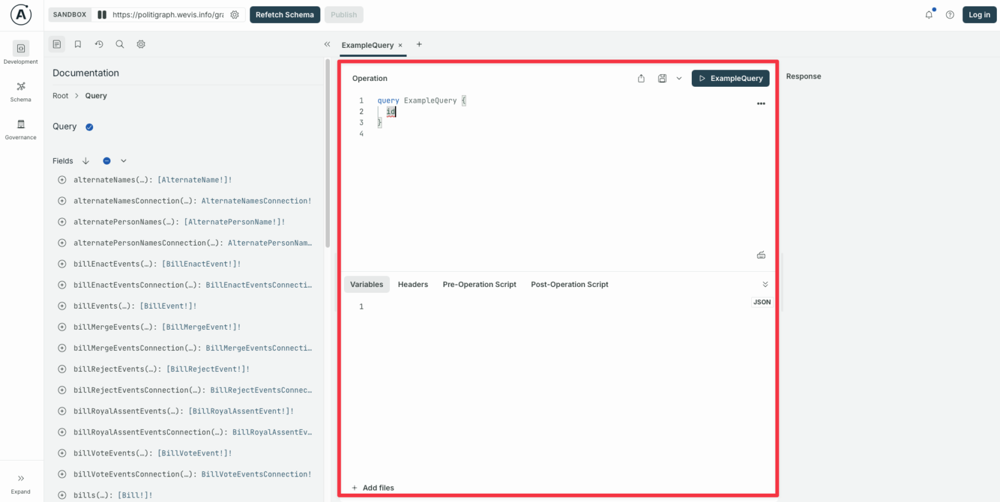
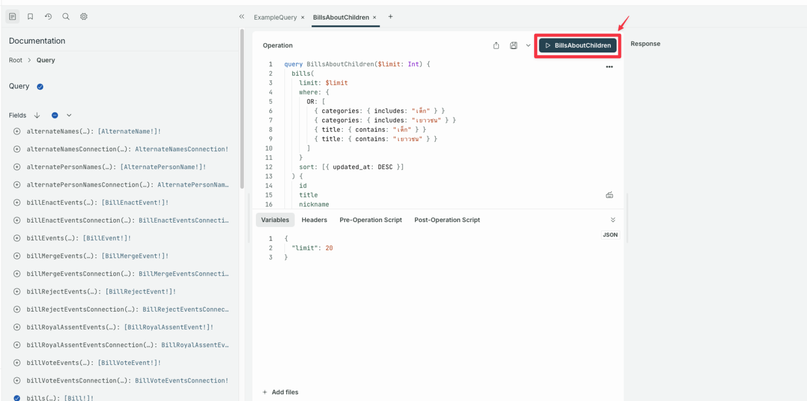
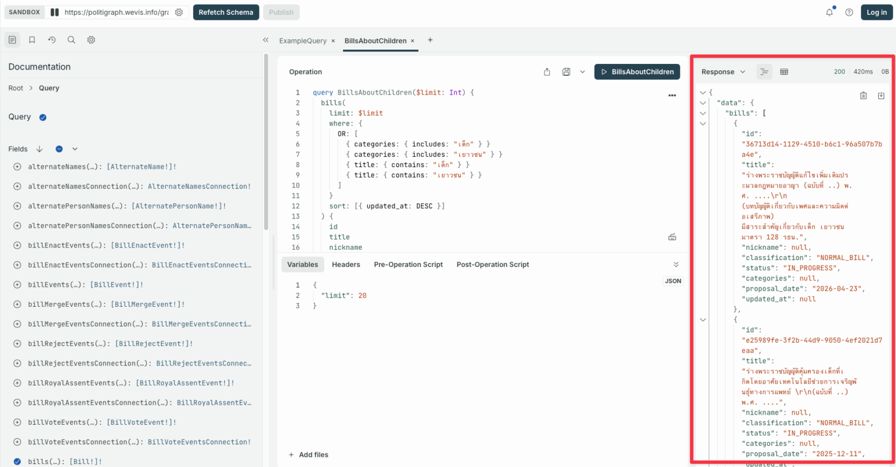
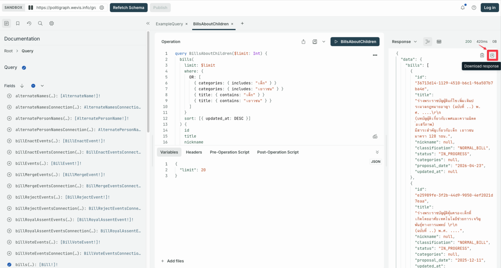

import { Steps } from '@astrojs/starlight/components';

เหมาะสำหรับผู้ที่ต้องการดึงข้อมูลจาก Politigraph ออกมาใช้ โดยมี User Interface ช่วยในการเขียน GraphQL Query ดูผลลัพธ์ และดาวน์โหลดข้อมูลไปใช้ได้ทันทีโดยไม่ต้องเขียนโค้ดเพิ่มเติม

<Steps>

1.  เปิด [GraphQL Playground](/graphql)

2.  เขียน Query ในช่องที่ถูกล้อมกรอบดังภาพ

    

3.  กดปุ่ม ▶️ เพื่อเรียกข้อมูล

    

4.  ข้อมูลจะปรากฏที่ช่อง Response

    

5.  กดปุ่ม download ข้อมูลออกมาในรูปแบบ JSON

    

    :::note
    Safari และ Firefox มีข้อจำกัดในการดาวน์โหลดข้อมูลจาก GraphQL Playground แต่ผู้ใช้ยังสามารถ Copy ผลลัพธ์ไปใช้ต่อได้
    :::

</Steps>
