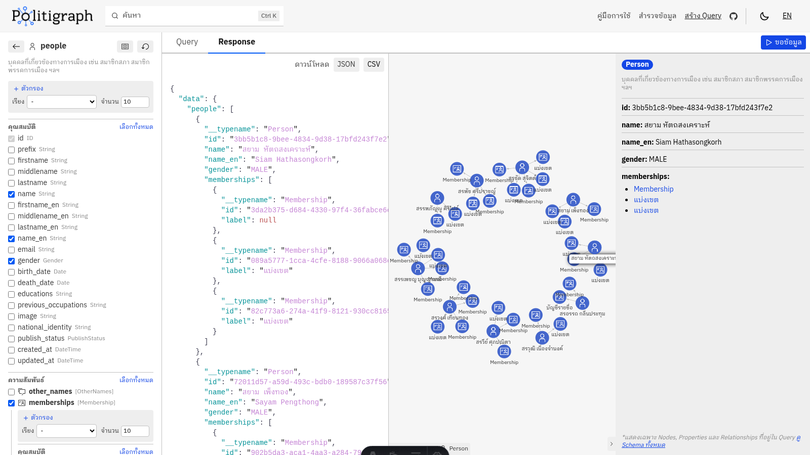
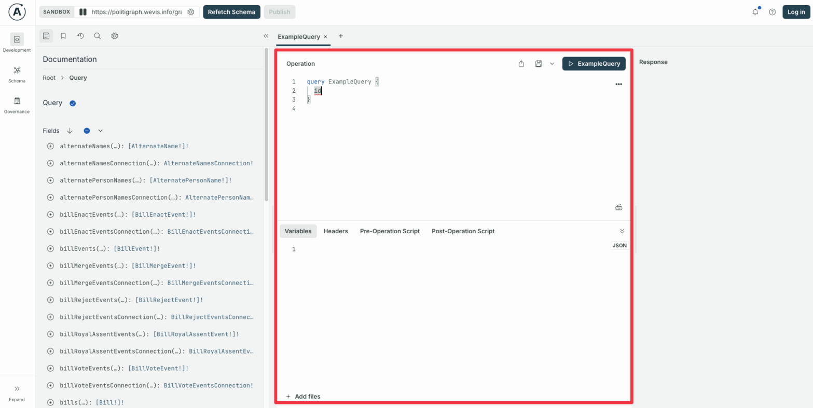
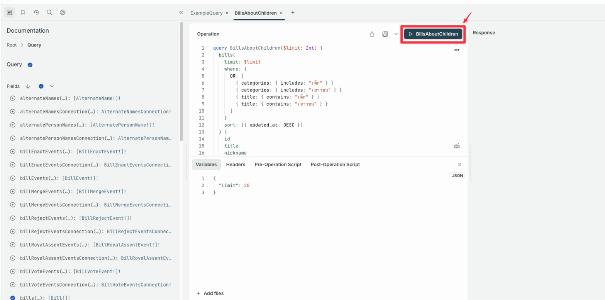
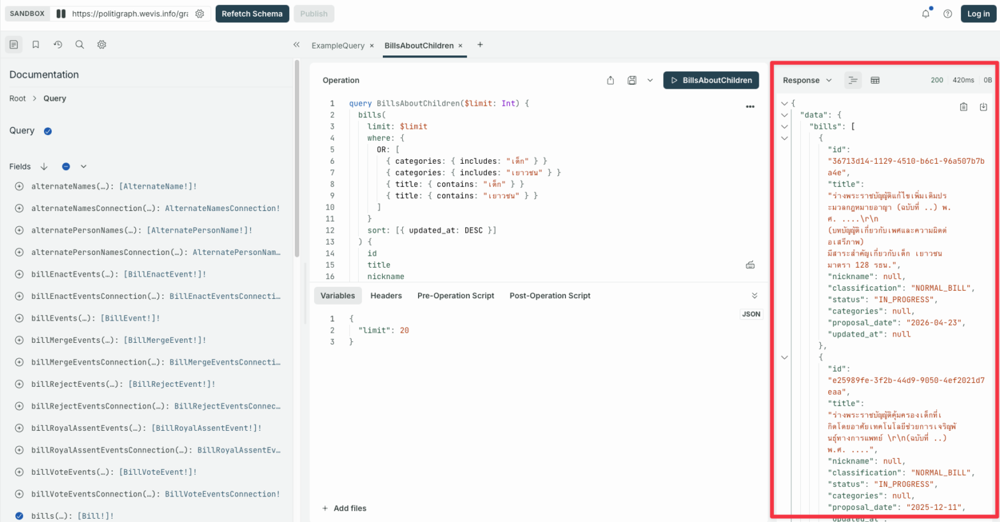
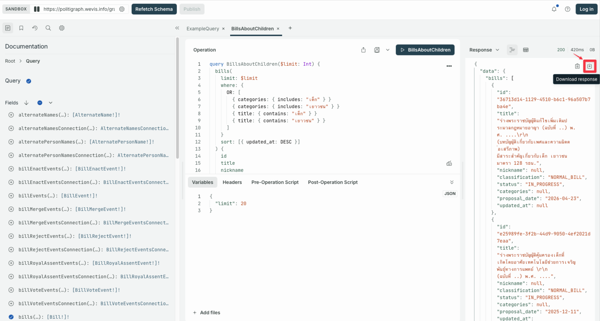

import { Steps } from '@astrojs/starlight/components';

เหมาะสำหรับผู้ที่ต้องการดึงข้อมูลจาก Politigraph ออกมาใช้ โดยมี User Interface ช่วยสร้าง Query ดูผลลัพธ์ และดาวน์โหลดข้อมูลไปใช้ได้ทันทีโดยไม่ต้องเขียนโค้ดเพิ่มเติม เรามี 2 เครื่องมือให้เลือกใช้

- [Query Builder](#query-builder): เหมาะสำหรับผู้ที่เริ่มต้นใช้ Politigraph สามารถกดเลือกข้อมูลที่ต้องการแบบง่ายๆ เพื่อสร้าง GraphQL Query และแสดงผลพร้อม Visualization
- [GraphQL Playground](#graphql-playground): สำหรับผู้ใช้ที่มีความเชี่ยวชาญมากขึ้น สามารถเขียน Query ที่ซับซ้อนมากขึ้น ใช้ GraphQL ได้เต็มความสามารถ

## Query Builder

<Steps>

1.  เปิด [Query Builder](/query-builder) แล้วเลือก **Nodes เริ่มต้น** ที่สนใจ เช่น `people` (บุคคล) หรือ `bills` (ร่างกฎหมาย)

2.  เลือกข้อมูลที่ต้องการในแถบด้านซ้าย

    - **คุณสมบัติ**: เลือก Property ที่ต้องการ
    - **ความสัมพันธ์**: ติ๊กเลือกข้อมูลที่เชื่อมโยงกัน เช่น `memberships` ของ `people` แล้วเลือก Property ของข้อมูลนั้นต่อได้
    - **ตัวกรอง เรียง และจำนวน**: จำกัดผลลัพธ์ให้เหลือเฉพาะข้อมูลที่ต้องการ

3.  กดปุ่ม **ขอข้อมูล** เพื่อเรียกข้อมูล ผลลัพธ์จะแสดงที่แท็บ **Response** ในรูปแบบ JSON หรือ Visualization

    

4.  ดาวน์โหลดผลลัพธ์เป็น **JSON** หรือ **CSV** ได้ที่มุมขวาบนของผลลัพธ์

    หากข้อมูลมีความสัมพันธ์ซ้อนกันหลายชั้น การดาวน์โหลด CSV จะได้ไฟล์ ZIP ที่แต่ละไฟล์ CSV ไฟล์ด้านในคือข้อมูลของ Node หนึ่งประเภท โดยเชื่อมกันด้วย `id`

5.  ที่แท็บ **Query** สามารถคัดลอก **ลิงก์** เพื่อแชร์ Query ให้ผู้อื่นเปิดดูต่อ หรือคัดลอก **โค้ด** ของ GraphQL Query ไปใช้ใน [GraphQL API](/usage/api) หรือ [GraphQL Playground](#graphql-playground) ได้

</Steps>

:::note
Query Builder รองรับเฉพาะการสร้าง Query พื้นฐานเพื่อให้ใช้งานได้ง่าย หากต้องการใช้ความสามารถของ GraphQL ได้ครบทุกอย่าง ให้ใช้ GraphQL Playground
:::

## GraphQL Playground

เหมาะสำหรับผู้ที่คุ้นเคยกับ GraphQL หรือได้ Query มาจากที่อื่นแล้ว เช่น จาก [AI](/usage/ai)

<Steps>

1.  เปิด [GraphQL Playground](/graphql)

2.  เขียน Query ในช่องที่ถูกล้อมกรอบดังภาพ

    

3.  กดปุ่ม ▶️ เพื่อเรียกข้อมูล

    

4.  ข้อมูลจะปรากฏที่ช่อง Response

    

5.  กดปุ่ม download ข้อมูลออกมาในรูปแบบ JSON

    

    :::note
    Safari และ Firefox มีข้อจำกัดในการดาวน์โหลดข้อมูลจาก GraphQL Playground แต่ผู้ใช้ยังสามารถ Copy ผลลัพธ์ไปใช้ต่อได้
    :::

</Steps>
